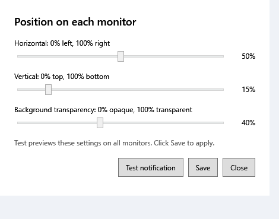
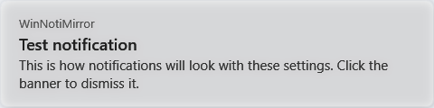

<div align="center">


# WinNotiMirror

**Your Windows notifications, on every screen.**

A lightweight Windows tray app that mirrors toast notifications across all connected displays, with adjustable placement and background transparency.


[Screenshots](#screenshots) · [Getting started](#getting-started) · [Usage](#usage) · [Development](#development)

</div>

## Features

- **Every display:** show matching notification banners on each connected monitor.
- **Adjustable placement:** choose horizontal and vertical position using percentage sliders; banners use the working area above the taskbar.
- **Background transparency:** adjust the banner background while keeping text readable.
- **Quick dismissal:** banners disappear after six seconds, or when clicked.
- **Stacked notifications:** multiple banners stack and reposition when dismissed.
- **Tray controls:** open settings, pause or resume mirroring, enable startup with Windows, and exit.
- **Instant preview:** test settings on all monitors before saving, even while mirroring is paused.
- **Saved preferences:** restore position and transparency on the next launch.

## Screenshots

### Notification settings



### Notification preview



Images are captured from the application's rendered WPF controls with built-in test content. Native window borders and the desktop are omitted.

## Getting started

### Requirements

- Windows 10 version 2004 (build 19041) or later, or Windows 11. Sparse-package registration uses APIs introduced in build 19041.
- .NET 8 SDK.
- Windows SDK **10.0.22621.0**, including `makeappx.exe` and `signtool.exe`. The packaging script expects its tools in `C:\Program Files (x86)\Windows Kits\10\bin\10.0.22621.0\x64`.
- Administrator access for the one-time development certificate trust step.

### Build and set up

Clone this repository, then run these commands from its root on Windows.

1. Build the application:

   ```powershell
   dotnet build src/WinNotiMirror/WinNotiMirror.csproj
   ```

2. Enable Developer Mode in Windows Settings for local development if required by your machine's sideloading policy.

3. Open **Windows PowerShell as Administrator** and create the local development signing certificate:

   ```powershell
   .\packaging\New-DevCert.ps1
   ```

4. Build and sign the sparse package in PowerShell:

   ```powershell
   .\packaging\Build-Package.ps1
   ```

5. Start the app:

   ```powershell
   dotnet run --project src/WinNotiMirror/WinNotiMirror.csproj
   ```

The first launch registers the sparse package and relaunches the application with Windows package identity. Grant notification access when prompted. The app then stays in the system tray.

## Usage

Right-click the **Windows Notification Mirror** tray icon to access:

| Control | Action |
| --- | --- |
| Settings… | Adjust position and background transparency. |
| Pause mirroring / Resume mirroring | Temporarily stop or resume incoming notification banners. |
| Start with Windows | Toggle startup for the current Windows user. |
| Exit | Close the application and remove the tray icon. |

In **Settings**, click **Test notification** to preview the current slider values on all monitors. Click **Save** to apply and persist them, or **Close** to discard edits.

Preferences are stored locally in `%LOCALAPPDATA%\WinNotiMirror\settings.json`. Defaults are 50% horizontal position, 15% vertical position, and 40% background transparency. The same values apply to every monitor.

## How it works

`UserNotificationListener` receives newly added Windows toast notifications. The app extracts their text and application icon, then creates a WPF overlay on each display using `System.Windows.Forms.Screen.AllScreens`.

A sparse MSIX package supplies the package identity required by the notification listener. The executable remains outside the package and is activated through Windows `shell:AppsFolder`.

## Development

```text
src/WinNotiMirror/       WPF application, listener, tray, and settings
  Assets/               Application and tray icon
  Models/               Notification data model
packaging/              Sparse-package manifest and signing scripts
  Assets/               Package logos
docs/screenshots/       Settings and notification preview images
```

Build with `dotnet build src/WinNotiMirror/WinNotiMirror.csproj`. Exit the running app before rebuilding the same configuration to avoid executable file locks. Rebuild `packaging/sparse.msix` after changing the manifest or package assets.

There is no committed automated test suite. Before submitting behavior changes, check notification access, banners on every display, stacking and click dismissal, pause/resume, settings persistence, startup toggling, and clean exit. Include mixed-DPI displays when testing positioning.

## Troubleshooting

- **“Setup incomplete”:** create the development certificate and build `packaging/sparse.msix`, then restart the app.
- **No mirrored notifications:** confirm notification access was granted and mirroring is not paused. Restart after changing access.
- **Windows SDK tools not found:** install SDK 10.0.22621.0, or adjust `$sdkBin` in `packaging/Build-Package.ps1` to your installed SDK tools directory.
- **Package registration fails:** verify that the development certificate is trusted and its subject matches the manifest publisher. Moving an already registered executable may require registering the package again for its new location.

## Security and local files

Notification contents appear on every connected display; keep this in mind when sharing a screen. Settings stay local, and the application has no notification-upload service.

Development certificates, signed packages, build outputs, and temporary files are excluded from Git. The signing scripts use a fixed development-only certificate password; generate certificates locally and use separate signing credentials for any production distribution.
